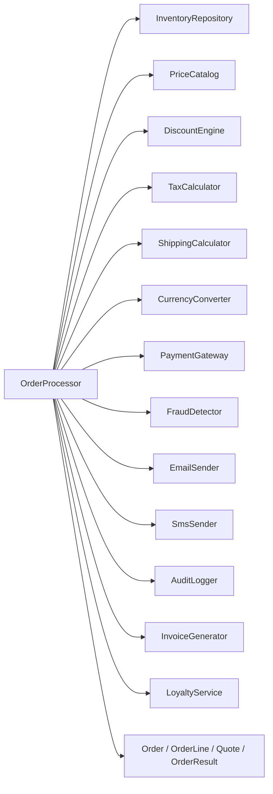
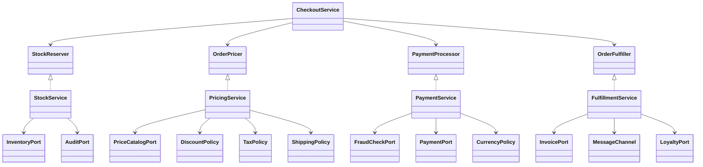

# ЛР №8. Об'єктно-орієнтований аудит системного дизайну та інтерфейсна декомпозиція класів-мутантів (CK & MOOD)

> Мова: Java 21 · проєкт `labs3` · пакет `lab8` · інструменти: SonarQube REST API, `tools/CkMetrics.java`, Git.
> Позначки **TODO(студент)** — те, що можна зробити лише на твоїй машині (скріншоти, живі відповіді сервера).

## 0. Важливе застереження щодо метрик SonarQube

Community Edition **не віддає** через `api/measures/component` метрики `coupling_between_objects`, `lcom4`, `depth_in_tree`, `class_complexity`
та MOOD (MHF/AHF/COF). Скрипт `scripts/lab8/sonar-ck.*` спочатку питає `api/metrics/search`, які ключі існують, і запитує лише їх
(`complexity`, `cognitive_complexity`, `ncloc`, ...). Відсутні ключі фіксуються в `docs/lab8/sonar/requests.log`.
Щоб не вигадувати цифр, CK/Lorenz-Kidd/MOOD рахує **`tools/CkMetrics.java`** за байткодом (`target/classes`) і віддає JSON
у форматі, схожому на Sonar API. У звіті обидва джерела показано окремо.

## Завдання 1. Видобуток метрик

### 1.1 Декларація API-запитів
```bash
export SONAR_TOKEN=<токен>  PROJECT_KEY=labs3
sonar-scanner
bash scripts/lab8/sonar-ck.sh        # або .\scripts\lab8\sonar-ck.ps1 у PowerShell
```
Еквівалент однієї команди:
```bash
curl -u $SONAR_TOKEN: "http://localhost:9000/api/measures/component?component=labs3:src/main/java/lab8/legacy/OrderProcessor.java&metricKeys=complexity,cognitive_complexity,ncloc"
```
**TODO(студент):** вставити `docs/lab8/sonar/requests.log` та скріншот Postman.

### 1.2 Аналітичний JSON-пакет
- Sonar (сира відповідь): **TODO(студент)** — вміст `docs/lab8/sonar/src_main_java_lab8_legacy_OrderProcessor.java.json`.
- Локальний CK-аналізатор (`docs/lab8/metrics/task2-baseline.json`), фрагмент:
```json
{"key": "lab8.legacy.OrderProcessor", "measures": [
  {"metric":"class_complexity","value":"24"},{"metric":"coupling_between_objects","value":"17"},
  {"metric":"rfc","value":"62"},{"metric":"lcom_hs","value":"0.89"},{"metric":"lcom4","value":"4"},
  {"metric":"depth_in_tree","value":"1"}]}
```

### 1.3 Зведена таблиця CK & MOOD (Baseline)

| Роль | Клас | WMC | CBO | RFC | LCOM-HS | LCOM4 | DIT |
|---|---|---|---|---|---|---|---|
| Core Domain | `legacy.OrderProcessor` | 24 | **17** | 62 | **0.89** | 4 | 1 |
| Infrastructure | `infra.PaymentGateway` | 10 | 0 | 9 | 0.50 | 2 | 1 |
| Utility / DTO | `model.Order` (record) | 14 | 2 | 18 | n/a | n/a | 2 |

Глобальні MOOD (19 типів, 24 зв'язки): **MHF = 10.3 %**, **AHF = 100 %**, **COF = 7.02 %**.

### 1.4 Первинний архітектурний вердикт
Інкапсуляція станів хороша (AHF = 100 %), але `OrderProcessor` — класичний **God Object**: CBO = 17 (> 15) на 13 власноруч створених
(`new`) конкретних залежностей, RFC = 62, LCOM-HS = 0.89 (методи працюють із непересічними групами полів: склад, ціни, оплата, нотифікації).
Інфраструктура й DTO в нормі. Дизайн — «зріла інкапсуляція, але моноліт з жорстким зачепленням»; потрібна інтерфейсна декомпозиція.

## Завдання 2. God Object → інтерфейсна декомпозиція

### 2.1 Baseline Coupling Matrix
**TODO(студент):** скріншот Dependency Matrix / MetricsReloaded / граф IDE для `OrderProcessor`. Схема того, що має бути видно:

Git-стан: коміт `arch(audit): baseline object design snapshot with god object (OrderProcessor)`.

### 2.2 Протокол симуляції збою (FAIL) — Shotgun Surgery
Зміна лише в стороньому класі `TaxCalculator`: `calculate(double)` → `calculate(double, Region, boolean)` (нова бізнес-вимога: ставка за регіоном, B2B без ПДВ).
Результат (`docs/lab8/logs/task2-fail-compile.log`) — три розрізнені місця в God Object ламаються одночасно:
```
src/main/java/lab8/legacy/OrderProcessor.java:59: error: method calculate in class TaxCalculator cannot be applied to given types;
        double taxRefund = tax.calculate(quote.subtotal() - quote.discount());
                              ^
  required: double,Region,boolean
  found:    double
  reason: actual and formal argument lists differ in length
src/main/java/lab8/legacy/OrderProcessor.java:76: error: method calculate in class TaxCalculator cannot be applied to given types;
        return tax.calculate(subtotal - discounts.discount(order.coupon(), subtotal));
                  ^
  required: double,Region,boolean
  found:    double
  reason: actual and formal argument lists differ in length
src/main/java/lab8/legacy/OrderProcessor.java:88: error: method calculate in class TaxCalculator cannot be applied to given types;
        double taxAmount = tax.calculate(subtotal - discount);
                              ^
  required: double,Region,boolean
  found:    double
  reason: actual and formal argument lists differ in length
3 errors
```
Коміт: `arch(audit): capture god object coupling failure, FAIL`.

### 2.3 Архітектурний Blueprint
`OrderProcessor` розбито на 4 сервіси з однією відповідальністю + тонкий оркестратор. Усі зв'язки — через інтерфейси (`lab8.port`),
залежності передаються через конструктор; composition root є лише в тестах (`Lab8TestWiring`).

Приклад контракту та реалізації:
```java
public interface TaxPolicy { double calculate(double taxable, Region region, boolean business); }
public class TaxCalculator implements TaxPolicy { ... }
public class PricingService implements OrderPricer {
    public PricingService(PriceCatalogPort catalog, DiscountPolicy discounts, TaxPolicy tax, ShippingPolicy shipping) { ... }
}
```
Зміна сигнатури податку тепер торкається **одного** порту й одного адаптера; `PricingService` та інші сервіси не змінюються.

### 2.4 Фінальна таблиця метрик (PASS)
Джерело: `docs/lab8/metrics/task2-pass.json` (після рефакторингу; **TODO(студент):** повторити `sonar-scanner` + скріншот GREEN/PASS).

| Клас | WMC | CBO | RFC | LCOM-HS | LCOM4 |
|---|---|---|---|---|---|
| `CheckoutService` | 6 | 6 | 14 | 0.00 | 1 |
| `PricingService` | 3 | **7** | 19 | 0.00 | 1 |
| `PaymentService` | 7 | 6 | 14 | 0.00 | 1 |
| `FulfillmentService` | 4 | 5 | 13 | 0.00 | 1 |
| `StockService` | 7 | 4 | 17 | 0.00 | 1 |

Максимальний CBO нового класу: **7 ≤ 8**; максимальний LCOM-HS: **0.00 ≤ 0.2**. Було: CBO = 17, LCOM-HS = 0.89.
MOOD: MHF 1.5 %, AHF 100 %, COF 3.24 % (було 7.02 %; кількість типів змінилась 19 → 39 через інтерфейси).
Поведінку збережено: ті самі сценарії проходять у `OrderProcessorCharacterizationTest` (до) і `CheckoutServiceTest` (після).

## Завдання 3. Inheritance Hell → композиція

### 3.1 Baseline (Lorenz–Kidd)
Ієрархія: `BaseReportService` → `AuditedReportService` → `PremiumReportService`.

| Клас | DIT | PIM | NOM | NOO (override) | NOA (added) |
|---|---|---|---|---|---|
| `BaseReportService` | 1 | 12 | 12 | 0 | 12 |
| `AuditedReportService` | 2 | 15 | 9 | 6 | 3 |
| `PremiumReportService` | **3** | **25** | 20 | **10** | 10 |

DIT ≥ 3, PIM > 20, 10 перевизначень, які ще й викликають `super` на кожному рівні — ознаки Inheritance Hell.

### 3.2 Краш-тест (FAIL)
Єдина зміна в базовому класі: `String render()` → `List<String> render()`. Компілятор (`docs/lab8/logs/task3-fail-compile.log`):
```
src/main/java/lab8/report/AuditedReportService.java:20: error: render() in AuditedReportService cannot override render() in BaseReportService
    @Override public String render() { track("render"); return super.render(); }
                            ^
  return type String is not compatible with List<String>
src/main/java/lab8/report/AuditedReportService.java:20: error: method does not override or implement a method from a supertype
    @Override public String render() { track("render"); return super.render(); }
    ^
src/main/java/lab8/report/AuditedReportService.java:20: error: incompatible types: List<String> cannot be converted to String
    @Override public String render() { track("render"); return super.render(); }
                                                                           ^
src/main/java/lab8/report/PremiumReportService.java:26: error: render() in PremiumReportService cannot override render() in BaseReportService
    @Override public String render() { return watermark + separator() + super.render(); }
                            ^
  return type String is not compatible with List<String>
4 errors
```
Зміна «простріляла» крізь два рівні нащадків. Коміт: `arch(audit): capture inheritance fragility crash, FAIL`.

### 3.3 «Успадкування проти Композиції»
До:
```java
public class AuditedReportService extends BaseReportService {
    @Override public String render() { track("render"); return super.render(); }
}
public class PremiumReportService extends AuditedReportService {
    @Override public String render() { return watermark + separator() + super.render(); }
}
```
Після:
```java
public interface ReportService { String title(); String render(); String export(String type); String filename(); }
public class AuditedReportService implements ReportService {
    private final ReportService delegate;                       // DI через конструктор
    public AuditedReportService(ReportService delegate) { this.delegate = delegate; }
    @Override public String render() { track("render"); return delegate.render() + " [audited]"; }
}
public class PremiumReportService implements ReportService {
    private final ReportService delegate;
    @Override public String render() { return watermark + "\n\n" + delegate.render() + " | " + signature(); }
}
// збірка: new PremiumReportService(new AuditedReportService(new ReportEngine()), "ACME")
```
Колишній батько (`BaseReportService`) став `ReportEngine` — звичайним класом, який тепер лежить у приватному полі делегата.
Зміна типу `render()` у `ReportEngine` більше не може зламати «нащадків»: вони бачать лише інтерфейс.

### 3.4 Фінальні метрики (PASS)
Джерело: `docs/lab8/metrics/task3-pass.json`.

| Клас | DIT | PIM | NOO |
|---|---|---|---|
| `ReportEngine` | **1** | 4 | **0** |
| `AuditedReportService` | **1** | 7 | **0** |
| `PremiumReportService` | **1** | 10 | **0** |

Додатково тест `ReportCompositionTest.noInheritanceBetweenReportClasses` не дасть повернутися до `extends`.
**TODO(студент):** підтвердити DIT/Overridden у SonarQube/IDE-плагіні (скріншот GREEN/PASS), якщо сервер їх віддає.

## Git History
Очікувана послідовність (`git log --oneline --graph`) — **TODO(студент):** вставити скріншот.
```
refactor(audit): replace inheritance with composition pattern, PASS
arch(audit): capture inheritance fragility crash, FAIL
arch(audit): baseline inheritance hierarchy snapshot (DIT=3)
refactor(audit): eliminate god object via interface decomposition, PASS
arch(audit): capture god object coupling failure, FAIL
arch(audit): baseline object design snapshot with god object (OrderProcessor)
```

## Лог валідації ШІ-Техліда
**TODO(студент):** додати власний протокол діалогу з ШІ згідно з Регламентом.
